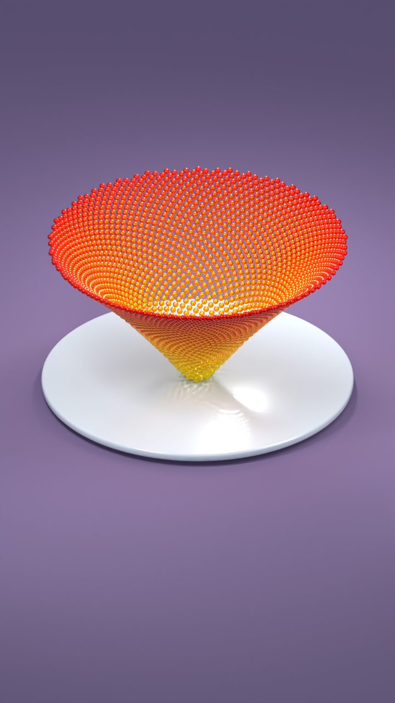

# AI Relax — Blender bouncing balls

Bộ dựng lại video thư giãn với **2.566 hạt xếp xoắn hoa hướng dương**, kim loại vàng–cam–đỏ sáng, đĩa kính trắng viền hẹp và nền tím dịu. Tất cả mô hình, chuyển động và tiếng gõ được tạo bằng mã, không cần API trả phí.



## Chạy trên máy khác

1. Cài **Blender 5.2.3 LTS** nếu muốn gần môi trường đã kiểm tra nhất; cài **Python 3.11+**, **FFmpeg và FFprobe có libx264/AAC**. Phiên bản đã chạy: Blender 5.2.3, Python 3.13, NumPy 2.3.4 đi kèm Blender, FFmpeg 9.0.2. Không cần `pip install` để render.
2. Clone repo; nếu Blender/FFmpeg chưa ở PATH, đặt đường dẫn executable như dưới đây.
3. Chạy `doctor`, ảnh thử, rồi kiểm tra ngắn trước khi render video dài.

PowerShell trên Windows:

```powershell
git clone https://github.com/anhladung/ai-relax.git
cd ai-relax
$env:BLENDER_BIN = 'C:\Program Files\Blender Foundation\Blender 5.2\blender.exe' # sửa theo máy bạn
python run.py doctor
python run.py still
python run.py smoke --samples 4 --scale 25
```

macOS/Linux dùng `python3` thay `python`. Ví dụ macOS:

```bash
export BLENDER_BIN=/Applications/Blender.app/Contents/MacOS/Blender
python3 run.py doctor
python3 run.py still
```

Nếu thiếu FFmpeg trong PATH, đặt `FFMPEG_BIN` và `FFPROBE_BIN` tới hai executable. Trên Windows có thể dùng `py -3` thay `python` nếu trình khởi chạy Python đã được cài. Xem [hướng dẫn chuyển máy](docs/PORTABILITY.md).

## Các lệnh

```bash
python run.py build                       # dựng scene.blend từ đầu, không render
python run.py still                       # dựng và render một ảnh ở frame 135
python run.py reference                   # mở checkpoint mới nhất và render ảnh
python run.py smoke --samples 4 --scale 25 # 6 khung liên tiếp, âm thanh, MP4 + kiểm tra
python run.py video                       # CHỈ khi cần video: đủ 300 khung, 10s, 30fps
python run.py video --out outputs/my-video
python run.py video --out outputs/my-video --resume
python run.py verify --out outputs/my-video
```

Mặc định **Cycles CPU** để giảm phụ thuộc GPU/driver. Render video có thể lâu trên CPU; kiểm tra ngắn trước. `--threads 6`, `--samples 16`, `--scale 50` cho phép giảm tải; muốn resume phải giữ nguyên preset/engine/samples/scale. Thư mục có dữ liệu không bị ghi đè nếu không có `--resume` hợp lệ.

Muốn dùng Eevee tùy chọn: `python run.py still --engine eevee --gpu-backend vulkan`. Đây không phải mặc định; Vulkan không có trên mọi máy. Không ép Vulkan trên macOS. Kính/bóng có thể khác Cycles. Nếu bị lỗi driver, quay lại Cycles CPU, đừng tiếp tục lặp lại backend bị crash.

## Có gì trong repo?

- `run.py`, `scripts/`: launcher, dựng cảnh độc lập, chuyển động, âm thanh, kiểm tra video.
- `presets/bright-metal-v06.json`: các tham số của cảnh mới nhất, không gắn đường dẫn ổ đĩa.
- `assets/approved-v06.blend`: checkpoint đã làm sạch, không ảnh/texture/library ngoài; `approved-v06.png` là ảnh gốc để đối chiếu.
- `assets/rebuilt-preview.png`: ảnh dựng lại từ mã đã chạy thử; không phụ thuộc checkpoint.
- `skills/ai-relax`: skill tổng hợp cho Codex. [Cài skill](docs/PORTABILITY.md#skill-codex-tùy-chọn).
- `vendor/blender-skills`: bản các skill Blender đã dùng, kèm giấy phép MIT. Pipeline không yêu cầu cài chúng.
- `provenance/scripts`: các script thử nghiệm cũ còn trên máy, chỉ để truy vết; **không dùng làm entrypoint**.
- `docs/`: yêu cầu hình ảnh, nguồn công cụ/skill, giới hạn mô phỏng, kết quả kiểm tra.
- `.github/workflows/tests.yml`: kiểm tra mô hình/tiếng trên Windows, Linux, macOS; không thay thế render test trên máy đích.

## Mức tái lập

Chuyển động, bố cục và preset được cố định; âm thanh dùng seed cố định. Cảnh không cần MCP, model AI, font, texture, file Downloads hay file ở phiên bản trước. **Không thể bảo đảm ảnh giống từng pixel trên mọi GPU/driver/phiên bản Blender.** Chọn cùng phiên bản và Cycles CPU để giảm sai khác; chạy `reference` và đối chiếu ảnh mẫu. Đã kiểm tra thực tế trên Windows hiện tại; máy đích cần chạy smoke test.

Đây là mô hình **đạn đạo thẳng đứng độc lập**, không phải bộ giải va chạm giữa các hạt. Các hạt ban đầu hơi lấn nhau để lấp khe đen theo yêu cầu. Bóng được renderer tính từ đèn/hình học; không dùng ảnh bóng cố định. Đọc [mô hình và giới hạn](docs/MODEL.md).

Ảnh mới nhất đã được dựng; video với look mới nhất chưa được render toàn bộ sau bước chốt ảnh. Lệnh `video` sẽ tạo look mới này; repo không giả định video v04 tối màu là bản mới nhất.
